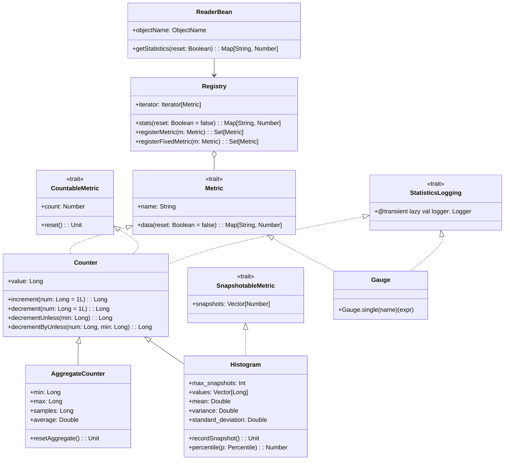

# Scalarometer — Architecture Documentation

## Overview

Scalarometer (`com.scalarometer.statistics`) is a lightweight Scala 3 LTS telemetry library providing thread-safe counters, aggregates, gauges, bounded histograms, stopwatches, and an `Iterable` metrics registry with optional JMX exposure.

It is specifically structured to be embedded in JVM and GraalVM Native Image applications (such as `tablo2hdhomerun`, `press`, `scant-ddns`, and `crispdb`) without imposing external runtime dependencies or reflection-heavy frameworks.

## Technology Stack

| Component | Version / Standard | Notes |
| :--- | :--- | :--- |
| **Language** | Scala `3.9.0` (LTS) | Emits LTS TASTy forward-compatible with Scala `3.9+` / `3.10+` (`2ad7517`) |
| **Target Bytecode** | Java `17` (`-release:17`, major `61`) | Built on JDK `25`; consumable on JDK `17`, `21`, and `25` (`2ad7517`) |
| **Runtime Dependencies** | `scala3-library_3` only | Zero third-party runtime deps; `scala3-compiler_3` isolated in `replCompiler` (`2ad7517`) |
| **Build System** | Gradle `9.9.2`, Shadow `9.6.1`, `java-library`, `maven-publish` | Strict `-Werror` + lint flags on both main and test compilation (`2ad7517`) |
| **Versioning** | `com.palantir.git-version:1.0.0` | Pure-Java JGit (`6.10.1.202505221210-r`) + Guava (`33.8.0-jre`) CVE constraints for `git`-less containers (`2ad7517`) |
| **Testing** | ScalaTest `3.2.20`, JUnit `4.13.2`, ScalaTestPlus `3.2.20.0` | 29 automated tests covering unit behavior, concurrency, serialization, and JMX (`c1ac060`) |
| **Logging** | `java.util.logging.Logger` | Operational logging with zero extra dependencies (`dd81ec4`) |

## Core Components

All classes live under `package com.scalarometer.statistics` (aligned with `src/main/scala/com/scalarometer/statistics/` in `dd81ec4` while preserving file paths and Git history back to `d899133`):

### Metric Implementations (`dd81ec4`)

- **[`Counter`](../src/main/scala/com/scalarometer/statistics/Counter.scala)**: Backed by `AtomicLong` for lock-free increments, decrements, atomic `data(reset = true)` via `getAndSet(0L)`, and overflow-safe CAS loops for `decrementUnless` and `decrementByUnless`. Exposes `+=` / `-=` operators and unboxed `value: Long`.
- **[`AggregateCounter`](../src/main/scala/com/scalarometer/statistics/AggregateCounter.scala)**: Tracks `min`, `max`, `samples`, and `average` across calls to `increment`. Uses explicit sample-count tracking (`_samples == 0L`) so zero and negative samples compute accurate bounds and averages without sentinel corruption. Emits `$name.min`, `$name.max`, and `$name.avg`.
- **[`Gauge`](../src/main/scala/com/scalarometer/statistics/Gauge.scala)**: Wraps a `(String, Boolean) => Map[String, Number]` callback for dynamic point-in-time sampling, with `Gauge.single(name)(expr)` for concise single-metric gauges.
- **[`Histogram`](../src/main/scala/com/scalarometer/statistics/Histogram.scala)**: Records incremental counter deltas up to `max_snapshots` (default `1024`, logging once at `FINE` level when capped until reset). Uses a Scala 3 `enum Percentile` (`P_000`..`P_100`) for linear interpolation, returns typed `Vector[Long]` (`values`) and boxed `Vector[Number]` (`snapshots`) without unsafe casts, and computes `mean`, `variance`, `standard_deviation`, and percentiles outside its synchronized snapshot lock.
- **[`Registry`](../src/main/scala/com/scalarometer/statistics/StatisticsRegistry.scala)**: Extends `Statistics` and `scala.collection.Iterable[Metric]`. Stores resettable (`countersRef`) and non-resettable (`fixedCountersRef`) metric sets in `AtomicReference[Set[Metric]]` updated via lock-free `updateAndGet`. `stats(reset = true)` atomically reads and resets regular metrics while reading fixed metrics with `reset = false`.
- **[`StopWatch`](../src/main/scala/com/scalarometer/statistics/StopWatch.scala)**: Uses a Scala 3 `enum State` (`STOPPED`, `RUNNING`) inside an immutable `TimingState` held by an `AtomicReference` for tear-free concurrent reads. Supports clock injection `StopWatch(clock)` for deterministic testing and `StopWatch.timed { ... }`.

## Concurrency & Serialization Guarantees

- **No lost updates on reset**: `Counter.data(reset = true)` uses `AtomicLong.getAndSet(0L)`; `AggregateCounter` and `Histogram` capture state and reset inside `synchronized` blocks (computing derived histogram statistics outside the lock).
- **Lock-free registry reads**: `Registry` stores immutable `Set[Metric]` snapshots in `AtomicReference`, allowing concurrent `stats()`, `iterator`, `metric()`, and `fixedMetric()` reads without blocking writers.
- **Java Serialization**: All metric classes declare `@SerialVersionUID(20200724110900L)` and inherit `@transient lazy val logger` from [`StatisticsLogging`](../src/main/scala/com/scalarometer/statistics/package.scala), ensuring serialization round-trips succeed without `NotSerializableException` (verified in `c1ac060`).

## JMX & GraalVM Native Image Compatibility

- **Standard MBean Compliance**: [`ReaderBean`](../src/main/scala/com/scalarometer/statistics/StatsReader.scala) extends `ReaderBeanMBean` (which extends `StatisticsBean`), satisfying JMX Standard MBean naming conventions under `com.scalarometer.statistics:type=ReaderBean`. `Registry.readerBean()` binds `ReaderBean(this)` so non-global registries register themselves rather than `Registry.global` (`dd81ec4`).
- **Native Image Safety**: `Statistics.initializeJmx()` is strictly opt-in (no-op unless `-Dcom.sun.management.jmxremote` is set) and catches `NonFatal` exceptions (such as `UnsupportedOperationException` when JMX monitoring is disabled in a native binary), logging errors without throwing.
- **Optional `compiler.native-image` Plugin**: [`buildSrc/src/main/groovy/compiler/NativeImage.groovy`](../buildSrc/src/main/groovy/compiler/NativeImage.groovy) provides a Gradle 9 Provider-API `NativeImageTask` modeled after `press` and `tablo2hdhomerun` for downstream or smoke-test native builds.

## Build, Packaging & CI Automation (`2ad7517`)

- **Library Artifacts**: `gradle jar` builds `scalarometer-<version>.jar` retaining all `.tasty` files for downstream Scala 3 compilation; `gradle sourcesJar` packages sources; `gradle shadowJar` produces `scalarometer-<version>-all.jar` (excluding `scala3-compiler_3`).
- **Containerized Dev Workflow**: [`scripts/docker-build`](../scripts/docker-build) runs Gradle inside `graalvm-dev:latest` with isolated `.gradle-docker/` and `.gradle-project-docker/` caches and JDK 25 `JAVA_TOOL_OPTIONS`. [`docker-build-test.sh`](../docker-build-test.sh) executes `gradle --no-daemon clean test --warning-mode all`.
- **Docker & GitHub Actions CI**: [`Dockerfile.jvm`](../Dockerfile.jvm) verifies compilation, unit tests, and JAR packaging on `eclipse-temurin:25-jdk-alpine`; [`.github/workflows/ci.yml`](../.github/workflows/ci.yml) validates script syntax, builds the [`docker/ci-toolchain.Dockerfile`](../docker/ci-toolchain.Dockerfile) image, runs the full test/package build, and uploads JAR artifacts.
