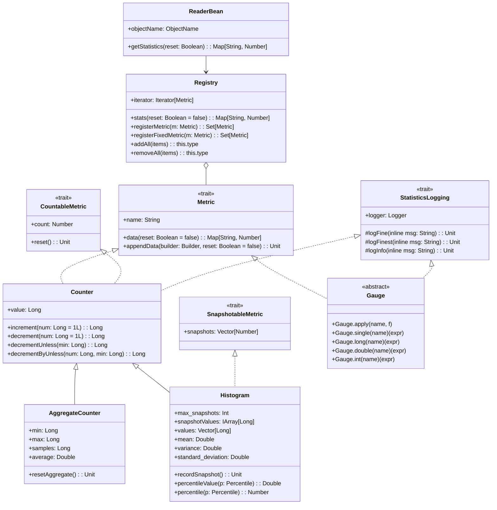

# Scalarometer — Architecture Documentation

## Overview

Scalarometer (`com.scalarometer.statistics`) is a lightweight, allocation-conscious Scala 3 LTS telemetry library providing thread-safe counters, aggregates, gauges, bounded histograms, stopwatches, and an `Iterable` metrics registry with optional JMX exposure.

It is specifically structured to be embedded in JVM and GraalVM Native Image applications (such as `tablo2hdhomerun`, `press`, `scant-ddns`, and `crispdb`) without imposing external runtime dependencies or reflection-heavy frameworks.

## Technology Stack

| Component | Version / Standard | Notes |
| :--- | :--- | :--- |
| **Language** | Scala `3.9.0` (LTS) | Emits LTS TASTy forward-compatible with Scala `3.9+` / `3.10+` (`2ad7517`); leverages `opaque type`, `inline`, `@targetName`, `IArray`, `@static`, `open`, `enum` + `derives CanEqual`, and `@PolymorphicSignature` `VarHandle` |
| **Compiler Optimization & Safety** | `-opt`, `-opt-inline:com.scalarometer.statistics.**`, `-language:strictEquality` | Scala 3.9 bytecode optimizer (package-scoped inlining) + strict equality + `-Werror` lint suite (`2ad7517`, `e6d3ce6`) |
| **Target Bytecode** | Java `17` (`-release:17`, major `61`) | Built on JDK `25`; consumable on JDK `17`, `21`, and `25` (`2ad7517`) |
| **Runtime Dependencies** | `scala3-library_3` only | Zero third-party runtime deps; `scala3-compiler_3` isolated in `replCompiler` (`2ad7517`) |
| **Build System** | Gradle `9.9.2`, Shadow `9.6.1`, `java-library`, `maven-publish` | Strict `-Werror` + lint flags on both main and test compilation (`2ad7517`) |
| **Versioning** | `com.palantir.git-version:1.0.0` | Pure-Java JGit (`6.10.1.202505221210-r`) + Guava (`33.8.0-jre`) CVE constraints for `git`-less containers (`2ad7517`) |
| **Testing** | ScalaTest `3.2.20`, JUnit `4.13.2`, ScalaTestPlus `3.2.20.0` | 46 automated tests covering unit behavior, concurrency, serialization, JMX, cross-package `inline` expansion, and deterministic `ThreadMXBean` allocation regression (`c1ac060`, `e6d3ce6`, `9e988d9`) |
| **Logging** | `java.util.logging.Logger` via `ClassValue[Logger]` | Zero per-instance logger fields + Scala 3 `inline` log level guards (`dd81ec4`, `9d0693d`) |

## Core Components

All classes live under `package com.scalarometer.statistics` (aligned with `src/main/scala/com/scalarometer/statistics/` in `dd81ec4` while preserving file paths and Git history back to `d899133`):

### Metric Implementations (`dd81ec4`, `9d0693d`–`9e988d9`)

- **[`StatisticsLogging`](../src/main/scala/com/scalarometer/statistics/package.scala)** (`9d0693d`): Caches `Logger` instances per concrete class in a `ClassValue[Logger]` instead of storing a `@transient lazy val` field on every metric instance. Exposes Scala 3 `inline` helpers (`logFine`, `logFinest`, `logInfo`) that compile to `if (logger.isLoggable(...))` guards with zero closure or string interpolation allocation when disabled.
- **[`Counter`](../src/main/scala/com/scalarometer/statistics/Counter.scala)** (`6978644`): Inlines its counter state directly as `@volatile private var _value: Long` paired with a `@static` `VarHandle` on `Counter.class` (cutting per-counter footprint from 2 heap objects to 1 and eliminating pointer chasing). Scala 3's native `@PolymorphicSignature` emits unboxed `(Counter, J)J` / `(Counter, JJ)J` JVM calls for `getAndAdd`, `getAndSet`, and `compareAndExchange` in `decrementByUnless`. Constructs standalone snapshots directly via `Map.Map1` and implements `Metric.appendData` for zero-intermediate-map registry aggregation.
- **[`AggregateCounter`](../src/main/scala/com/scalarometer/statistics/AggregateCounter.scala)** (`4e33225`): Tracks `min`, `max`, `samples`, and `average` across calls to `increment`. Uses explicit sample-count tracking (`_samples == 0L`) so zero and negative samples compute accurate bounds without sentinel corruption. `data()`, `appendData()`, and `toString()` capture primitive values into stack locals under `synchronized` (avoiding `Tuple4`/boxing) and perform boxing, `Map.Map3` allocation, and string formatting outside the monitor lock.
- **[`Histogram`](../src/main/scala/com/scalarometer/statistics/Histogram.scala)** (`8509b5e`): Replaces boxed `Vector[Long]` storage with a lazily grown primitive `Array[Long]` buffer (growing `0 -> 16 -> ... -> max_snapshots` with overflow-safe doubling and reused across `reset()` for zero steady-state allocations). Stores deduplicated percentile keys in a flat `Array[String]` indexed by `Percentile.ordinal` and caches `allPercentiles: IArray[Percentile]`. Computes `mean`, `variance`, and `standard_deviation` via unboxed primitive `while` loops, sorts copies in-place with `java.util.Arrays.sort`, exposes unboxed `percentileValue(p): Double` and Scala 3 `snapshotValues: IArray[Long]`, and populates `data()`/`appendData()` in a single builder pass.
- **[`Gauge`](../src/main/scala/com/scalarometer/statistics/Gauge.scala)** (`aa03462`, `9e988d9`): Abstract base class with specialized `final` subclasses (`MultiGauge`, `SingleGauge`, `LongGauge`, `DoubleGauge`, `IntGauge`) avoiding unused fields, wrapper closures, and intermediate maps during `Registry.stats()`. `Gauge.long`, `Gauge.double`, and `Gauge.int` expand inline onto `@FunctionalInterface` `Serializable` primitive SAM traits (`LongSampler`, `DoubleSampler`, `IntSampler`) so Scala 3 avoids unspecialized `Function0` boxing while preserving full Java Serialization support.
- **[`Registry`](../src/main/scala/com/scalarometer/statistics/StatisticsRegistry.scala)** (`b16914b`): Extends `Statistics` and `scala.collection.Iterable[Metric]`. Stores resettable and fixed metrics in atomic `MetricBucket(metrics: Set[Metric], byName: Map[String, Metric])` snapshots updated via allocation-free `@tailrec` CAS loops that skip locked CAS on no-op register/unregister calls. Provides O(1) `metric`/`fixedMetric`/`get`/`contains` lookups, O(1) `isEmpty`, zero-`Set`-allocation `size`/`iterator`/`foreach`, bulk `++=`/`--=` operators (materializing single-use `Iterator`s once for safe CAS retries), and single-pass `stats(reset)` using `Map.newBuilder` + `Metric.appendData` with an empty-registry singleton fast path.
- **[`StopWatch`](../src/main/scala/com/scalarometer/statistics/StopWatch.scala)** (`3e0d68c`, `9e988d9`): Uses a Scala 3 `enum State derives CanEqual` inside a static `TimingState` (no hidden `$outer` pointer) with a shared `InitialState` constant for zero-allocation construction and `reset()`, allocation-free `@tailrec` CAS transitions, and a `java.util.function.LongSupplier` clock with direct `System.nanoTime()` fast-path. Exposes zero-allocation `opaque type Marker = Long` (with `.timestamp`, `.elapsed`, `.elapsedNanos` extension methods and `@targetName("elapsedFromMarker")` overload disambiguation), compile-time constant `inline val NanosPerMilli`, and zero-overhead `inline def timed` / `timedNanos`.

## Memory Footprint & Throughput Architecture

| Component | Optimization Strategy | Steady-State Allocation (Verified in `PerformanceSpec`) | Commit |
| :--- | :--- | :--- | :--- |
| **`StatisticsLogging`** | `ClassValue[Logger]` + `inline` level guards | 0 instance fields; 0 B when `FINE`/`FINEST` disabled | `9d0693d` |
| **`Counter`** | `@volatile var _value: Long` + `@static` `VarHandle` + `Map.Map1` | 1 heap object (~24 B vs ~48 B); **0 B/op** on `increment`/`decrement`/`decrementByUnless`/`value` | `6978644` |
| **`AggregateCounter`** | Stack-local lock capture + `Map.Map3` + `appendData` | Minimal monitor hold time; 1 `Map3` vs 8 intermediate allocations | `4e33225` |
| **`Histogram`** | Reusable primitive `Array[Long]` + unboxed loops + `Arrays.sort` + `IArray` | ~8 KB in 1 `long[]` at 1,024 samples (vs ~30 KB / 1,057 objects); **0 B/op** steady-state `incrementByAndRecordSnapshot` across resets | `8509b5e` |
| **`StopWatch`** | `opaque type Marker = Long` + `inline timed`/`timedNanos` + `LongSupplier` + `@tailrec` CAS | **0 B/op** on `mark()`, `elapsed(marker)`, `reset()`, and custom `LongSupplier` clocks | `3e0d68c`, `9e988d9` |
| **`Gauge`** | Specialized `SingleGauge` / primitive SAM `LongGauge`/`DoubleGauge`/`IntGauge` | 0 wrapper closures; 0 intermediate `Map`s in `Registry.stats()` | `aa03462`, `9e988d9` |
| **`Registry`** | `MetricBucket` O(1) index + single-pass `Map.newBuilder` + `appendData` + fast `Iterable` | **0 B/op** on `isEmpty`, `size`, `contains`, empty `stats()`, and no-op `unregisterMetric` | `b16914b` |
| **Bytecode Optimizer** | Scala 3.9 `-opt`, `-opt-inline:com.scalarometer.statistics.**`, `-language:strictEquality` | Method-local + package-internal bytecode optimization with deterministic `ThreadMXBean` verification | `e6d3ce6` |

## Concurrency & Serialization Guarantees

- **No lost updates on reset**: `Counter.data(reset = true)` uses `VarHandle.getAndSet(this, 0L)`; `AggregateCounter` and `Histogram` capture primitive state / array slice and reset inside `synchronized` blocks (computing derived statistics, sorting, and building `Map`s outside the lock).
- **Lock-free registry reads**: `Registry` stores immutable `MetricBucket` snapshots in `AtomicReference`, allowing concurrent `stats()`, `iterator`, `foreach`, `metric()`, `fixedMetric()`, and `contains()` reads without blocking writers.
- **Java Serialization**: All metric classes declare `@SerialVersionUID(20261126010000L)`, inherit field-free `StatisticsLogging`, and use serializable primitive arrays/fields or `@FunctionalInterface` `Serializable` SAM samplers (`Gauge`), verified by round-trip tests across every metric type (`c1ac060`, `aa03462`, `9e988d9`).

## JMX & GraalVM Native Image Compatibility

- **Standard MBean Compliance**: [`ReaderBean`](../src/main/scala/com/scalarometer/statistics/StatsReader.scala) extends `ReaderBeanMBean` (which extends `StatisticsBean`), satisfying JMX Standard MBean naming conventions under `com.scalarometer.statistics:type=ReaderBean`. `Registry.readerBean()` binds `ReaderBean(this)` so non-global registries register themselves rather than `Registry.global` (`dd81ec4`).
- **Native Image Safety**: `Statistics.initializeJmx()` is strictly opt-in (no-op unless `-Dcom.sun.management.jmxremote` is set) and catches `NonFatal` exceptions (such as `UnsupportedOperationException` when JMX monitoring is disabled in a native binary), logging errors without throwing. Static final `VarHandle` (`Counter`) and `ClassValue` (`StatisticsLogging`) are natively supported and lowered by GraalVM Native Image without runtime reflection configuration.
- **Optional `compiler.native-image` Plugin**: [`buildSrc/src/main/groovy/compiler/NativeImage.groovy`](../buildSrc/src/main/groovy/compiler/NativeImage.groovy) provides a Gradle 9 Provider-API `NativeImageTask` modeled after `press` and `tablo2hdhomerun` for downstream or smoke-test native builds.

## Build, Packaging & CI Automation (`2ad7517`, `e6d3ce6`, `1b2bafc`, `0453e10`–`2481dd4`)

- **Library Artifacts**: `gradle jar` builds `scalarometer-<version>.jar` retaining all `.tasty` files for downstream Scala 3 compilation; `gradle sourcesJar` packages sources; `gradle shadowJar` produces `scalarometer-<version>-all.jar` (excluding `scala3-compiler_3`, JAR signature files, and `META-INF/maven/**`). All archives enforce `preserveFileTimestamps = false` and `reproducibleFileOrder = true` for deterministic, cache-friendly JARs (`0453e10`).
- **Gradle & Disk-I/O Tuning (`0453e10`)**: [`gradle.properties`](../gradle.properties) enables `org.gradle.caching=true`, `org.gradle.parallel=true`, disables inotify `org.gradle.vfs.watch=false` for ephemeral containers, and configures ParallelGC + Compact Object Headers + C1-only `-XX:TieredStopAtLevel=1` on both the Gradle daemon and forked Scala Zinc compiler workers (while keeping full C2 JIT on the forked `test` JVM). HTML and JUnit XML test reports are opt-in via `-PtestReports=true` to avoid writing dozens of report files per test run.
- **Containerized Dev Workflow (`1b2bafc`, `4453efe`)**: [`scripts/docker-build`](../scripts/docker-build) runs Gradle inside `graalvm-dev:latest` with persisted `.gradle-docker/caches/` and `.gradle-project-docker/`, mounts RAM `tmpfs` over `/tmp`, `.gradle-docker/daemon`, `.gradle-docker/.tmp`, and `.gradle-docker/notifications` (eliminating transient host disk writes), suppresses the Gradle welcome banner (`-Dorg.gradle.welcome=never`), and forwards the host's global gitignore read-only to `/root/.config/git/ignore` for clean non-`.dirty` `gitVersion()` artifacts. [`docker-build-test.sh`](../docker-build-test.sh) defaults to incremental `test` and supports `--clean` plus passthrough Gradle arguments.
- **Docker & GitHub Actions CI (`1b2bafc`, `2481dd4`)**: [`Dockerfile.jvm`](../Dockerfile.jvm) primes `buildSrc`, plugins, Maven dependencies (`resolveDependencies`), and the Scala 3.9.0 Zinc compiler bridge in a cached Docker layer before copying full sources and running `gradle --no-daemon --offline --no-build-cache test jar shadowJar` on `eclipse-temurin:25-jdk-alpine` (cutting rebuilds on source edits from ~57s to ~27s with zero network downloads), while [`.dockerignore`](../.dockerignore) preserves git-tracked docs/README so container JARs remain non-`.dirty`. [`.github/workflows/ci.yml`](../.github/workflows/ci.yml) caches `.gradle-docker/caches/{modules-2,jars-*,zinc-*}` across runs via `actions/cache@v4`, skips redundant `clean` and `--no-build-cache` writes on fresh checkouts, enforces that no `*.dirty*.jar` artifacts are generated, and uploads JAR artifacts.
